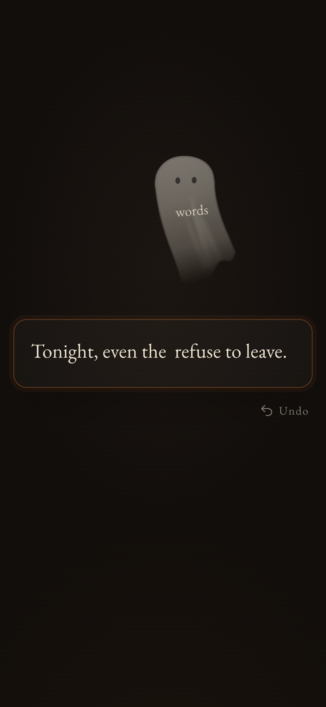
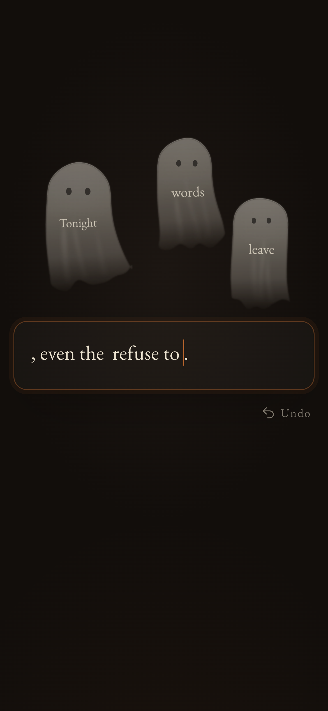

# Ghost Writer

> Nothing you delete really leaves.

**Live:** https://taliaren.github.io/ghost-writer/

A small Halloween writing toy. Text you delete doesn't disappear — it rises off
the page as a thin, translucent ghost and drifts in the air above the line.
Undo, and the ghost is pulled back head-first into the sentence, turning into
ordinary text again.

<p>
  
  
</p>

## Try it

- Type, select, delete — Backspace, Delete, or deleting a selection.
- Hold Backspace and the letters gather into one growing ghost.
- Undo with <kbd>⌘Z</kbd> / <kbd>Ctrl+Z</kbd> (redo with <kbd>⇧⌘Z</kbd> / <kbd>Ctrl+Y</kbd>).
  On phones, an **Undo** button appears under the box after you delete something.
- Move the mouse past a ghost and its gauze is pushed by the air.

## Run locally

```bash
npm install
npm run dev      # http://localhost:5178
npm run build    # static site in dist/
```

The build is a plain static site, so it can be hosted anywhere that serves
files (Vercel, Netlify, EdgeOne Pages, GitHub Pages…).

## How it works

- **Editing** uses a real `<textarea>` (caret, selection, paste, IME and emoji
  all behave natively). A mirrored backdrop renders the same text, which lets
  the app measure exactly where deleted text was and hide restored text until
  its ghost lands, so words never appear twice.
- **History** is the app's own: every change is diffed from the actual text
  (grapheme-aware), and each deletion is linked to its ghost, so undo/redo
  always follow the real edit order.
- **Ghosts** are live SVG outlines built around a bending spine — a steady
  head, a body and hem that follow on softer springs — with gradients that
  follow the body, a shared travelling breeze, and one `requestAnimationFrame`
  loop. No physics engine.

Built with React + TypeScript + Vite. Respects `prefers-reduced-motion`.
